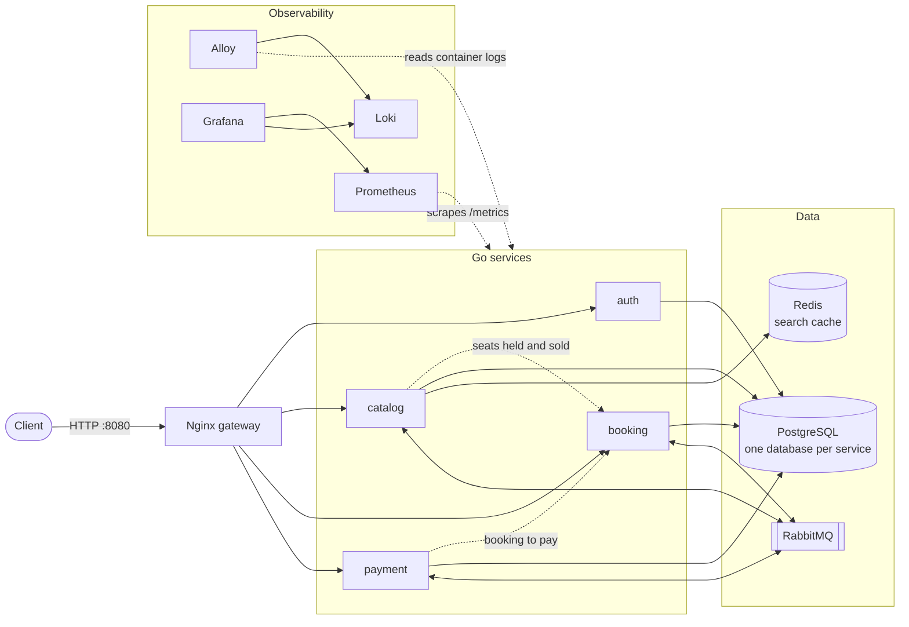
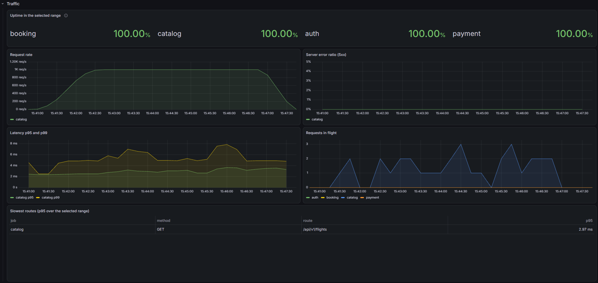

# GoTravel

A flight booking backend inspired by Traveloka, built as a set of Go microservices.

- Four services behind an Nginx gateway, each with its own PostgreSQL database
- Seats are never oversold: holds take seats in one conditional update, checked with 1,000 concurrent
  holds on a 100-seat flight
- Events between services go through RabbitMQ with a transactional outbox and idempotent consumers
- Flight search answers in 11 ms at p95 under 1,800 requests per second
- Metrics, logs and a Grafana dashboard come up with `make up`

## Architecture



| Service | Responsibility | API |
|---|---|---|
| `auth` | Users, registration, login, profile, JWT issuance | [openapi.yaml](services/auth/openapi.yaml) |
| `catalog` | Flight data, search, admin inventory endpoints | [openapi.yaml](services/catalog/openapi.yaml) |
| `booking` | Seat inventory, holds, booking lifecycle, admin analytics | [openapi.yaml](services/booking/openapi.yaml) |
| `payment` | Mock payments, reports payment results to booking | [openapi.yaml](services/payment/openapi.yaml) |

No service reads another's database. A service calls another over HTTP when it needs an answer now,
and otherwise keeps a copy fed by events. [docs/architecture.md](docs/architecture.md) has the event
list, the booking and payment states, and the hold-and-pay sequence.

## Scope

Phase 1 covers one-way, direct flights:

- Registration and login with JWT, profile editing
- Flight search by origin, destination, date and passenger count, with filters, sorting and pagination
- Seat reservation with a temporary hold, mock payment, then `CONFIRMED` or `EXPIRED`
- Admin: flight and capacity management, booking analytics

Round trips, multi-leg flights, seat maps, refunds and real payment gateways are out of scope.

## How a booking works

1. **Hold.** Booking takes the seats and stores the booking as `HELD` for 15 minutes, with the price at
   that moment. Catalog learns the new seat count from an event.
2. **Pay.** Payment checks with booking that the hold is still valid, records the mock payment, and
   publishes `payment.succeeded`. Booking then marks the booking `CONFIRMED` and the seats as sold.
3. **Expire.** A hold that is not paid in time becomes `EXPIRED` and its seats are released.

A payment can still arrive after its hold expired. Booking refuses it with `payment.rejected`, and
payment marks it `REVERSED`.

## Non-functional requirements

| Requirement | How | Evidence |
|---|---|---|
| Search under 500 ms | One query per route and day, filtered in Go; route-days cached in Redis | p95 11 ms at 1,800 req/s ([load test](docs/load-test.md)) |
| 99% uptime for booking | Healthcheck on every container and `restart: unless-stopped`; holds, expiry and events live in PostgreSQL, so a restart loses nothing | Uptime panel on the dashboard. One instance on one host, so a host failure is downtime |
| Every API instrumented | Shared router middleware records requests, duration and in-flight requests per route; Go runtime metrics per service | `/metrics` on every service, scraped by Prometheus |
| Passwords hashed with bcrypt | `auth` hashes on registration and compares on login | `services/auth` |
| Booking conflicts prevented | Seats taken with a conditional update in the hold transaction; PostgreSQL, never Redis, is the source of truth | 1,000 concurrent holds, exactly 100 of 100 seats held ([load test](docs/load-test.md#concurrent-holds)) |
| Caching | Redis route-day cache, 60 s, dropped on admin writes and seat changes; search falls back to PostgreSQL if Redis fails | Cache panels on the dashboard |
| Monitoring | Prometheus and a provisioned Grafana dashboard | `deploy/grafana/` |
| Logging | JSON logs with request IDs, shipped by Alloy to Loki | Warnings and errors panel |

## Getting started

Requirements: Docker with Compose v2, and `make`.

```sh
cp .env.example .env   # adjust values if needed
make up                # start the stack
make seed              # create demo flights (see "Demo data")
```

| URL | What |
|---|---|
| <http://localhost:8080> | API gateway (`GATEWAY_PORT` in `.env`) |
| <http://localhost:3000> | Grafana, login from `.env`; dashboard under GoTravel |
| <http://localhost:9090> | Prometheus |
| <http://localhost:15672> | RabbitMQ management |

Run `make` to list all targets.

### Demo data

`make seed` fills the catalog with flights through the gateway, signed in as the admin account from
`.env` (`ADMIN_EMAIL`, `ADMIN_PASSWORD`). It creates 14 days of flights starting tomorrow: 606 a day,
8,484 in total, from 8 airlines on 12 routes. One busy route, CGK to DPS, has 300 flights a day for
load testing.

Running it again is safe: existing flights are skipped and never changed. To start from scratch, run
`make reset` (it deletes all volumes) and `make up` again. For the other options, run
`go run ./tools/seed -h` with `ADMIN_EMAIL` and `ADMIN_PASSWORD` set.

### Try it

Works in any POSIX shell, including Git Bash (on macOS use `date -v+1d +%F`):

```sh
API=http://localhost:8080/api/v1
JSON='Content-Type: application/json'
field() { grep -o "\"$1\": *\"[^\"]*\"" | head -n1 | cut -d'"' -f4; }   # first "name":"value" in the JSON

curl -s -X POST $API/auth/register -H "$JSON" \
  -d '{"email":"jane.smith@example.com","password":"correct horse battery","full_name":"Jane Smith"}'
TOKEN=$(curl -s -X POST $API/auth/login -H "$JSON" \
  -d '{"email":"jane.smith@example.com","password":"correct horse battery"}' | field access_token)

# Search tomorrow's flights; date is the local date at the origin airport
FLIGHT=$(curl -s "$API/flights?origin=CGK&destination=DPS&date=$(date -d tomorrow +%F)&passengers=1&sort=price_asc" \
  | field id)

# Hold one seat, then pay
BOOKING=$(curl -s -X POST $API/bookings -H "$JSON" -H "Authorization: Bearer $TOKEN" \
  -d "{\"flight_id\":\"$FLIGHT\",\"passengers\":[{\"full_name\":\"Jane Smith\",\"birth_date\":\"1992-08-03\"}]}" \
  | field id)
curl -s -X POST $API/payments -H "$JSON" -H "Authorization: Bearer $TOKEN" -d "{\"booking_id\":\"$BOOKING\"}"

# Booking confirms once the payment event arrives: HELD for a moment, then CONFIRMED
sleep 1
curl -s $API/bookings/$BOOKING -H "Authorization: Bearer $TOKEN" | field status
```

### API gateway

Nginx is the only public entry point. Unknown paths return `404`, and every response carries an
`X-Request-ID` header, taken from the request or generated and forwarded to the service.

| Public path prefix | Service |
|---|---|
| `/api/v1/auth`, `/api/v1/users` | `auth` |
| `/api/v1/flights`, `/api/v1/admin/flights` | `catalog` |
| `/api/v1/bookings`, `/api/v1/admin/analytics/bookings` | `booking` |
| `/api/v1/payments` | `payment` |

`/internal/v1` paths, `/healthz` and `/metrics` are not exposed through the gateway.

## Observability and load tests



The GoTravel dashboard shows traffic, errors and latency per service, Go runtime metrics, the search
cache, holds and payments, RabbitMQ queues and dead letters, and warning and error logs.

Load tests run with k6 against the gateway (`make loadtest`, see [docs/load-test.md](docs/load-test.md)).
On one laptop, with k6 on the same machine:

| Search, 5 minutes | p50 | p95 | p99 | Errors |
|---|---|---|---|---|
| 1,000 req/s | 1.7 ms | 3.6 ms | 7.2 ms | 0 |
| 1,800 req/s | 2.5 ms | 11.3 ms | 42.6 ms | 0 |

Search peaks at about 2,700 req/s. 1,000 concurrent holds on a 100-seat flight held exactly 100 seats.

## Development

```sh
make test     # unit and integration tests (integration tests start containers, so Docker must run)
make lint     # golangci-lint
make fmt      # gofmt and goimports
make sqlc     # regenerate the query code after changing SQL
```

CI runs lint, the tests and an image build for every service.

```
services/<name>/     cmd (main), internal/<name> (handlers, service, events), migrations, queries, openapi.yaml
internal/platform/   shared infrastructure: config, logging, metrics, HTTP server, auth, database, messaging, outbox
deploy/              Nginx, PostgreSQL, Prometheus, Loki, Alloy and Grafana configuration
loadtest/            k6 scripts
tools/               key generation and demo data
docs/                architecture, design decisions, load test results
```

Every design choice and its trade-offs are recorded in [docs/decisions.md](docs/decisions.md).
