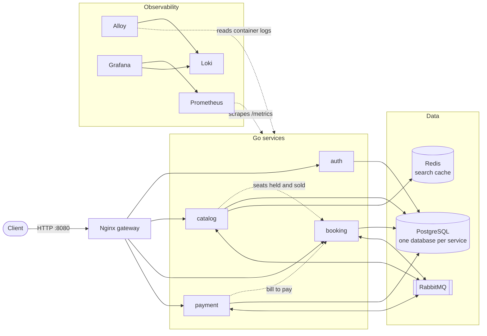
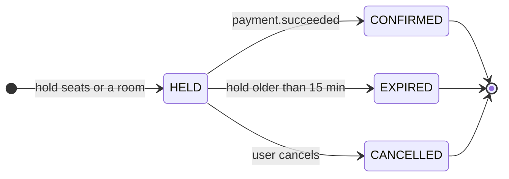
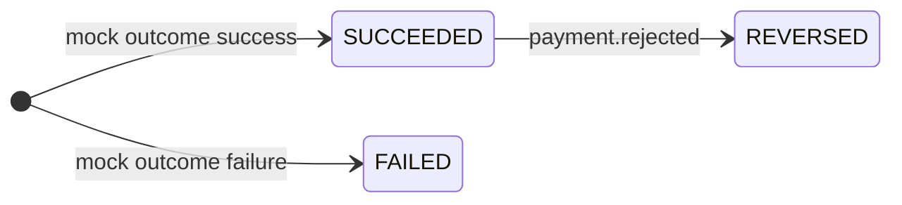
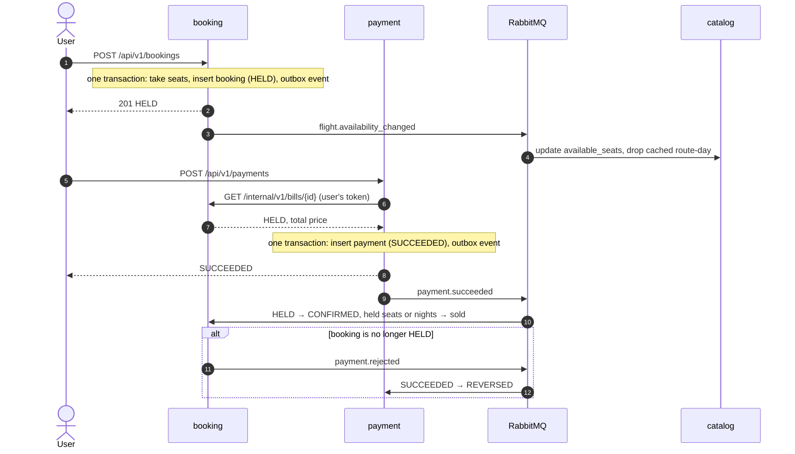
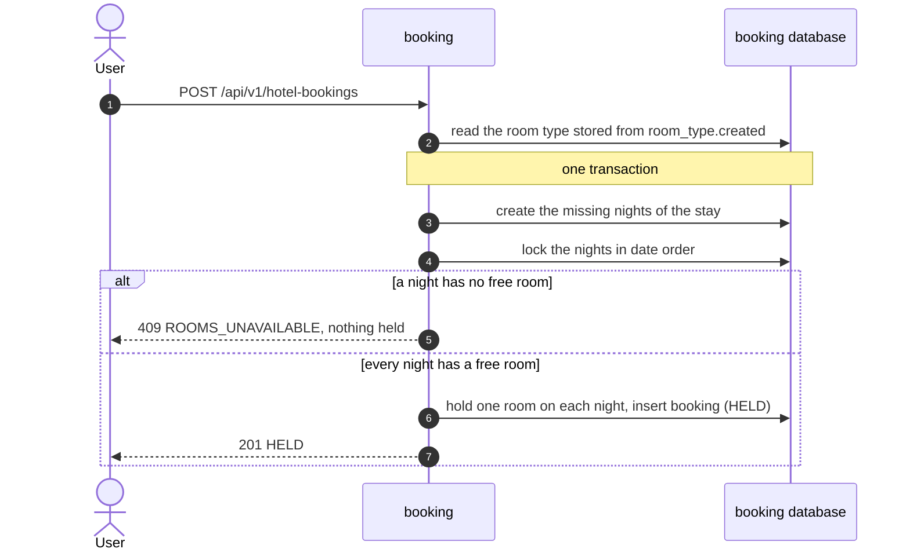

# Architecture

## Components

- **Nginx** is the only public entry point. It routes an allowlist of `/api/v1` paths and passes an
  `X-Request-ID` (the client's or a new one) to every service.
- **auth** signs JWTs with an Ed25519 key; the other services verify them with the public key.
- Each service has its own database and role on one PostgreSQL instance. No service reads another's
  database: it calls the service over HTTP (dotted arrows) or keeps a copy fed by events.
- Calls between services use `/internal/v1` paths directly, not through the gateway, and forward the
  caller's token: catalog reads a flight's seats before lowering its capacity, and payment reads the bill
  of a flight or hotel booking.

## Events

Services publish events through a transactional outbox: the event is written in the same transaction
as the change, and a relay publishes it to RabbitMQ. Delivery is at least once, so every consumer is
idempotent. A message that can never apply goes to a dead-letter queue.

| Event | From → to | Effect |
|---|---|---|
| `flight.changed` | catalog → booking | booking updates its seat inventory (capacity, departure, price) |
| `flight.availability_changed` | booking → catalog | catalog updates `available_seats` and drops the cached route-day |
| `room_type.created` | catalog → booking | booking stores the room type it holds rooms of |
| `payment.succeeded` | payment → booking | booking confirms a held flight or hotel booking |
| `payment.rejected` | booking → payment | payment reverses a payment for a booking that was no longer held |

## Booking and payment states

- A flight hold takes seats with one conditional update on booking's inventory row, which fails when
  fewer seats are free than passengers. Concurrent holds wait for the row lock, so seats are never
  oversold.
- A hotel hold takes one room on every night of the stay (see [Hotel hold](#hotel-hold)).
- Payment checks that the booking is still `HELD` and not past `expires_at` before charging. A payment
  can still arrive after the hold expired; booking then refuses it with `payment.rejected`, and payment
  marks it `REVERSED`.
- Background workers in booking move expired holds to `EXPIRED` and release their seats or nights.
  Hotel holds are expired one per transaction, so each transaction locks the nights of one stay only.

## Hold and pay

The sequence is the same for a hotel booking, with `POST /api/v1/hotel-bookings` and no availability
event. The user sees the payment succeed before the booking is confirmed; the booking shows `CONFIRMED`
a moment later, once the event has been applied.

## Hotel hold

Every transaction that changes nights (hold, cancel, expiry, confirmation) locks them in date order and
touches the nights of one booking only, so overlapping stays wait for each other instead of
deadlocking.

Design decisions and their trade-offs are in [decisions.md](decisions.md).
