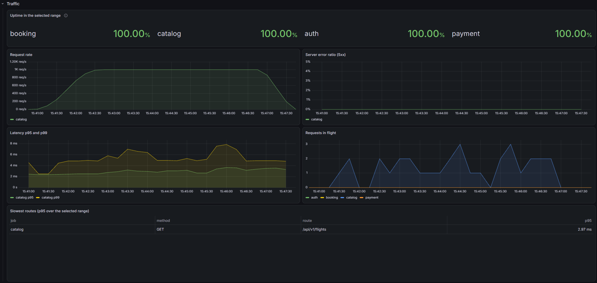
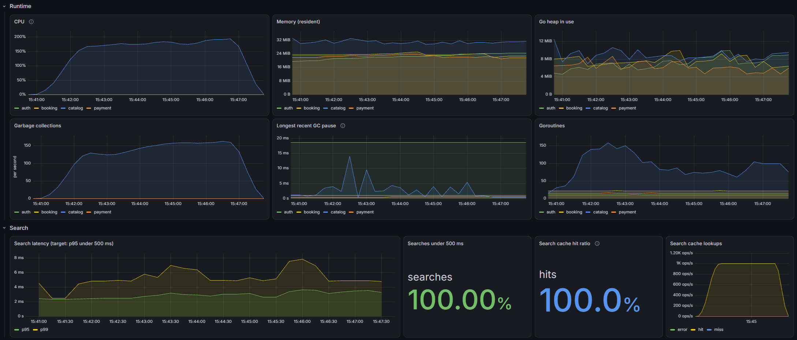
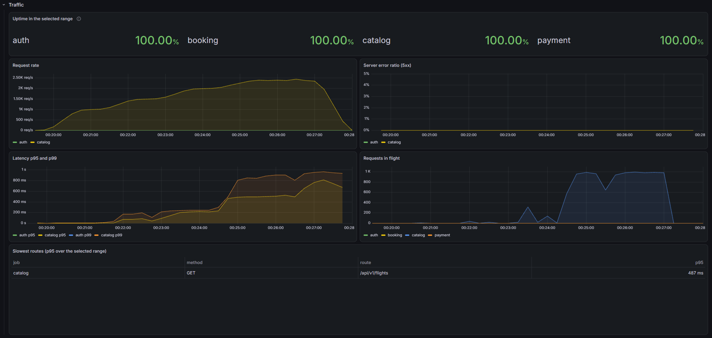
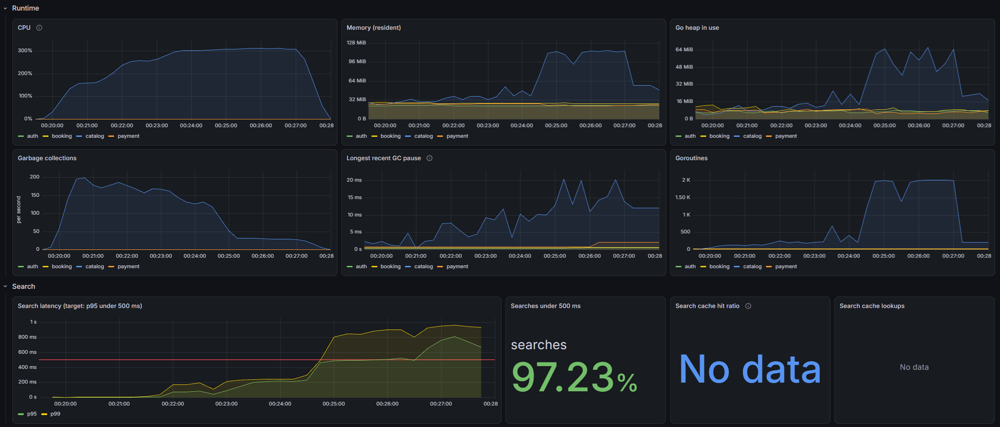
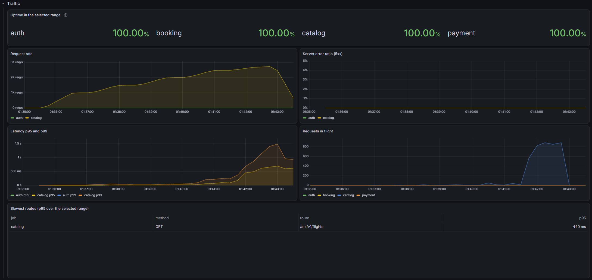
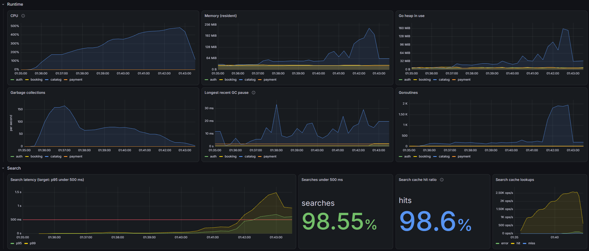

# Load test: flight search

Flight search was load tested with [k6](https://k6.io) through the gateway to check the target (p95 under
500 ms) and to find where the system stops keeping up.

## Summary

| Load (5 min, cache on) | p50 | p95 | p99 | Errors | Dropped |
|---|---|---|---|---|---|
| 1,000 req/s | 1.7 ms | 3.6 ms | 7.2 ms | 0 | 0 |
| 1,800 req/s | 2.5 ms | 11.3 ms | 42.6 ms | 0 | 0 |
| 2,400 req/s | 4.8 ms | 99 ms | 230 ms | 0 | 0.3% |

- The target holds with a wide margin up to 1,800 req/s.
- Peak throughput is about **2,400 req/s without the search cache** and **2,700 req/s with it**. Past
  that, requests queue and latency climbs; no request failed in any run.
- The cache does not make search faster here. It moves the work from PostgreSQL into catalog, which can
  be scaled out.
- Everything ran on one laptop together with k6, so these numbers describe this setup, not production.

## Setup

- **Machine:** AMD Ryzen 5 7640HS (6 cores, 12 threads), 24 GB, Windows. Docker sees 12 CPUs and
  11.3 GiB; the whole stack stayed under 2 GiB.
- **Stack:** the full `docker compose up` stack, including the observability services. k6 2.4.0 runs as a
  container and calls the gateway.
- **Requests** ([`loadtest/search.js`](../loadtest/search.js)): CGK → DPS on a random date 1–13 days
  ahead (from `make seed`), 1–3 passengers; 70% plain, 30% with an airline filter, price cap or sort.
- **Cache:** catalog caches a route-day in Redis for 60 s and filters it in memory; the hit ratio stays
  near 100%.
- **Dropped iterations:** k6 starts requests at a fixed rate. When all VUs are busy it cannot start the
  next one, so the target rate was not fully offered.

Latency in the tables is measured by k6. CPU, memory and throughput come from the Grafana dashboard,
except PostgreSQL, Redis, nginx and k6, which have no metrics and are read from `docker stats`.

```bash
make seed
RATE=1000 HOLD=5m make loadtest                                # steady
SCENARIO=stress STEPS=1000,1500,2000,2500,3000 make loadtest   # stress
CATALOG_REDIS_URL= docker compose up -d catalog                # turn the cache off
```

## Steady load

| Rate (cache on) | Requests | p50 | p95 | p99 | Dropped |
|---|---|---|---|---|---|
| 1,000 req/s | 330,295 | 1.7 ms | 3.6 ms | 7.2 ms | 0 |
| 1,800 req/s, run 1 | 593,898 | 2.4 ms | 11.3 ms | 41.7 ms | 400 (0.07%) |
| 1,800 req/s, run 2 | 593,028 | 2.6 ms | 20.6 ms | 97.1 ms | 1,264 (0.21%) |
| 1,800 req/s, run 3 | 594,293 | 2.5 ms | 11.3 ms | 42.6 ms | 0 |
| 2,400 req/s | 789,866 | 4.8 ms | 99.2 ms | 229.6 ms | 2,418 (0.31%) |





- Run 1 created VUs during the run, which is slow; the script now creates all of them up front.
- Run 2 hit a stall of the whole machine: all 300 VUs were waiting while catalog held only 26 requests.
- At 1,800 req/s catalog used about 320% CPU and 30–60 MiB of memory. All containers together used about
  5.4 of 12 logical CPUs, which on 6 physical cores is why the tail grows.
- 2,400 req/s is close to the peak: p95 still passes, but requests start to be dropped.

## Stress

1,000 to 3,000 req/s, 1 minute per step. Per-step values are read from the dashboard and approximate.

| Target | No cache: served | p95 | p99 | Cache: served | p95 | p99 |
|---|---|---|---|---|---|---|
| 1,000 | ~1,000 | ~2.5 ms | ~5 ms | ~1,000 | < 50 ms | < 50 ms |
| 1,500 | ~1,500 | ~80 ms | ~180 ms | ~1,500 | < 50 ms | < 50 ms |
| 2,000 | ~2,000 | ~220 ms | ~250 ms | ~2,000 | < 50 ms | < 50 ms |
| 2,500 | ~2,350 | ~500 ms | ~850 ms | ~2,450 | ~100 ms | ~250 ms |
| 3,000 | ~2,400 | 650–800 ms | ~950 ms | ~2,700 | 500–700 ms | 1–1.5 s |









Past the peak, requests queue inside catalog (900–1,000 in flight), not in nginx. Catalog keeps accepting
them: in the run with the cache it reached about 2,000 goroutines and 230 MiB of memory.

## Where the time goes

A search costs about **1.8 ms of CPU** either way:

- **With the cache:** all of it in catalog; PostgreSQL stays near 0%.
- **Without the cache:** about 1.25 ms in catalog and 0.5 ms in PostgreSQL (1.3 cores at 2,400 req/s).

What stops each run:

- **Without the cache**, catalog CPU stops at about 300% while the machine still has CPUs left. The limit
  is the database path: the connection pool (pgxpool's default, 12 connections here) or PostgreSQL. The
  pool has no metrics, so this fits the data but is not measured.
- **With the cache**, catalog CPU keeps rising to about 480%. The limit is most likely the laptop itself.

## Limitations

- **One shared laptop.** Results vary between runs at high load, and a short stall shows up as dropped
  requests and a long maximum, so maximum latency is not reported.
- **Small data set.** With more routes and dates, more searches would miss the cache.
- **Search only.** No holds or payments run during the test.
- **No overload protection.** Past its capacity, catalog's latency and memory grow until the load drops.
